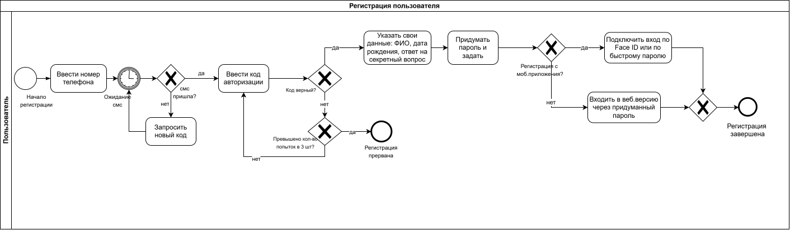
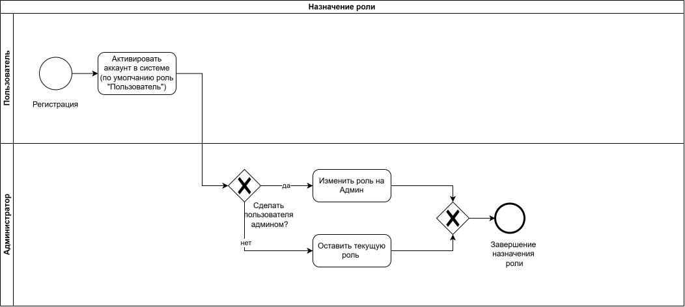

# Моделирование бизнес-процессов (BPMN)

В разделе представлены модели бизнес-процессов системы аутентификации и авторизации.

Диаграммы подготовлены в draw.io и описывают действия участников, последовательность операций и условия переходов.

## 1. Регистрация пользователя

Процесс отражает регистрацию по номеру телефона, подтверждение SMS-кода, ввод регистрационных данных и завершение создания учётной записи.

## 2. Назначение роли

Процесс описывает назначение пользователю роли USER по умолчанию и последующее изменение роли администратором.

## Исходные файлы

Редактируемые диаграммы хранятся в формате `.drawio`. Для просмотра непосредственно на GitHub используются экспортированные изображения SVG.
